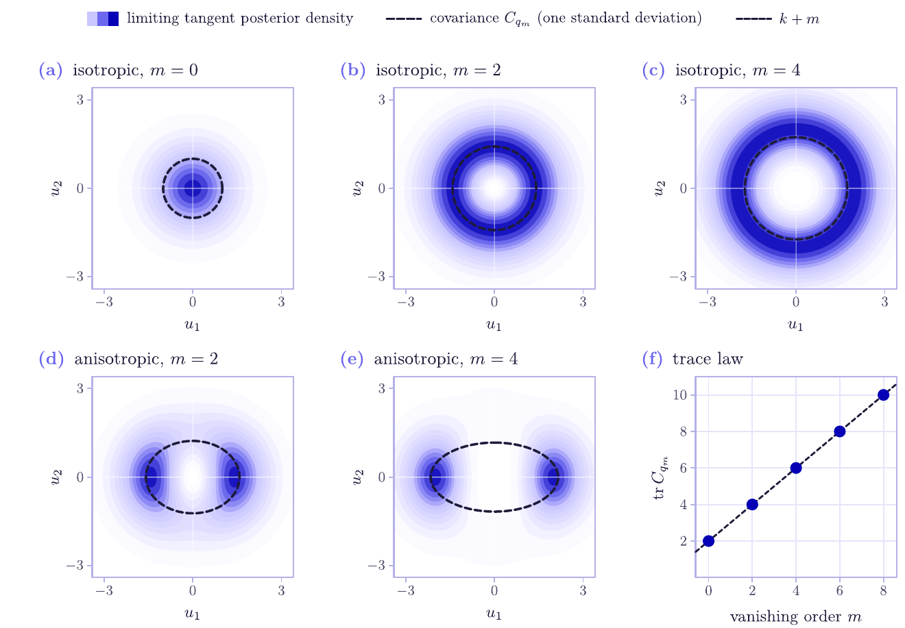

# Score Geometry at Vanishing Density

**Tilted-Gaussian Limits and Spectrally Calibrated Optimization**
Johannes Herter, Independent Researcher

[Paper (PDF)](https://johannesherter.com/papers/score-geometry-at-vanishing-density.pdf)

At small noise, the Jacobian of a Gaussian denoiser is usually read as the projector onto the tangent space of
the data manifold, but this fails where the data density vanishes. At a zero of finite order m, the normalized
posterior covariance converges to the covariance of a polynomially tilted Gaussian: its range is still the
tangent space, but its eigenvalues depend on the leading density jet and sum to k + m instead of k. Spectral
calibration, which keeps the top-k eigenspace and discards the scale, therefore recovers the tangent projector,
stably up to half the tangent-normal eigengap, and an optimizer that calibrates both its tangent step and its
landing step has a local stability interval that no longer depends on the vanishing order. Population
quadrature, repeated empirical-posterior estimation and 36 trained denoisers on circles and a rotated
16-dimensional plane separate recovery of the spectral range from recovery of the eigenvalue scale.



*Figure 1 of the paper: the limiting tangent posterior (shading) and its covariance (dashed) at a regular point
and at zeros of order 2 and 4. The vanishing order fixes the trace, the jet fixes the shape, and the range stays
the tangent space.*

## Contents

- `main.tex`, `appendix.tex`, `c2f.sty`, `math_commands.tex`, `references.bib`: manuscript source.
- `scripts/generate_figures.py`: population quadrature, finite-sample KDE, boundary-layer, landing and
  exact-linearization experiments.
- `scripts/train_learned_score.py`: the learned-denoiser experiments (36 noise-conditional MLPs) with analytic
  input Jacobians, and the end-to-end optimization sweeps.
- `scripts/plot_figures.py`, `scripts/figure_style.py`: the paper's figures, drawn from `results/`.
- `scripts/check_reproducibility.py`: consistency checks on the source and the recorded results.
- `results/`: every measurement behind the figures and tables, per replication, with summaries, seeds, run
  metadata and the numerical self-checks.
- `figures/`: the figures as vector PDFs.

## Reproducing

The recorded run used Python 3.12.13 and NumPy 2.3.5 on an arm64 CPU, without an accelerator; the pinned
dependencies are in `requirements.txt`. No external data, pretrained model or GPU is needed.

```bash
make setup         # Python 3.12 environment with the pinned dependencies
make experiments   # population, KDE, boundary-layer, landing and conditioning experiments -> results/
make learned       # trains the 12 seeds x 3 problems from scratch (170 s in the recorded run) -> results/
make figures       # draws figures/*.pdf from results/
make paper         # output/pdf/score-geometry-at-vanishing-density.pdf (needs tectonic)
make check         # labels, citations, figures and the recorded results
```

`make experiments` and `make learned` overwrite their files in `results/`; copy them first for a byte-for-byte
comparison. Both also write quick-look plots to `output/draft-figures/`. `train_learned_score.py --quick` is a
one-seed smoke test that overwrites the learned results and is not the reported run;
`train_learned_score.py --refresh-oracle` recomputes only the deterministic oracle rows of an existing run.

The paper's figures were drawn with Splinx, the author's figure tool, which is not public yet; `make figures` needs it
(`SPLINX_PYTHON`, `SPLINX_CLI`). Every number in the figures comes from the CSV files in `results/`, which the
experiments above regenerate, and the experiment scripts also write quick-look plots to `output/draft-figures/`.
`python scripts/plot_figures.py [results_dir] [figures_dir] [name ...]` draws a subset.

| Figure | File | Data in `results/` | Produced by |
|---|---|---|---|
| 1 Tilted-Gaussian limit and trace law | `tilted-posterior.pdf` | `tilted_posterior.csv` | `make experiments` |
| 2 Covariance spectra on the circle | `circle-spectrum.pdf` | `circle_spectrum.csv` | `make experiments` |
| 3 Finite-sample range and order recovery | `finite-sample-kde.pdf` | `finite_sample_kde.csv`, `finite_sample_kde_summary.csv` | `make experiments` |
| 4 Density-floor crossover | `crossover.pdf` | `crossover.csv` | `make experiments` |
| 5 Spatial boundary layer | `spatial-boundary-layer.pdf` | `spatial_boundary_layer.csv` | `make experiments` |
| 6 Normal-only landing | `landing-error.pdf` | `landing_error.csv` | `make experiments` |
| 7 Exact local stability | `conditioning.pdf` | `conditioning.csv`, `conditioning_stability_width.csv` | `make experiments` |
| 8 Learned circle geometry | `learned-geometry.pdf` | `learned_score_summary.csv` | `make learned` |
| 9 Rotated d = 16 plane | `learned-plane.pdf` | `learned_score_summary.csv` | `make learned` |
| 10 End-to-end optimization | `learned-optimization.pdf` | `learned_optimization_summary.csv`, `learned_score_summary.csv` | `make learned` |
| 11 Zero on a spiral | `spiral.pdf` | `spiral.csv` | `make experiments` |

Tables 1 and 2 come from `learned_score_summary.csv` and `learned_score_metrics.csv`, and the paired bootstrap
intervals quoted in the text from `learned_paired_bootstrap.csv` (all `make learned`); Table 4 comes from
`normal_offset_audit.csv` (`make experiments`).

## Seeds

Population integrals use periodic quadrature and no randomness. The KDE experiment uses seeds 20260819 to
20260866 and the spiral sample seed 20260821. Learned runs use base seed 2026081900, the fixed rotated-plane frame
2026081901 and paired bootstrap intervals 2026081999. Configuration, versions, platform and runtime are recorded
in `results/learned_run_metadata.json`.

## Citation

```bibtex
@misc{herter2026scoregeometry,
  title  = {Score Geometry at Vanishing Density: Tilted-Gaussian Limits and Spectrally Calibrated Optimization},
  author = {Herter, Johannes},
  note   = {Independent Researcher},
  year   = {2026},
  url    = {https://johannesherter.com/papers/score-geometry-at-vanishing-density.pdf}
}
```

## License

Manuscript text and source, figures, tables and result datasets are under CC BY 4.0 (`LICENSE-CONTENT`). The
code in `scripts/` and the `Makefile` are under the Apache License 2.0 (`LICENSE`).
